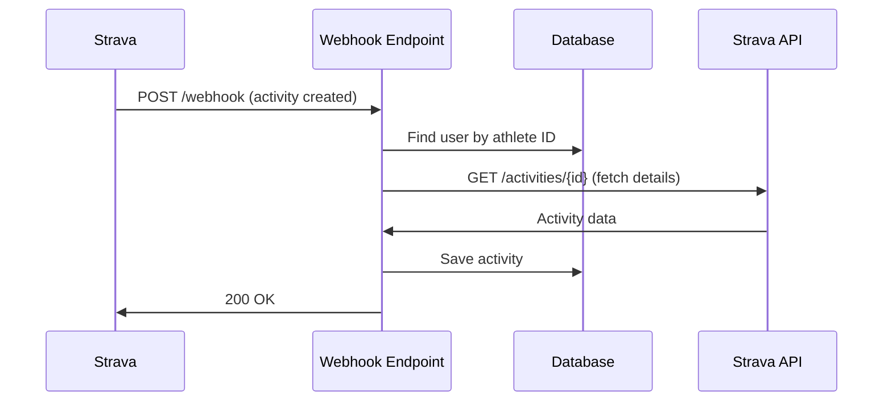

# Strava Webhook Setup Guide

This guide explains how to set up Strava webhooks to automatically receive activity events.

## Overview

Strava webhooks allow us to receive real-time notifications when:

- A user creates a new activity (run, ride, etc.)
- A user updates an activity
- A user deletes an activity
- A user deauthorizes our app

## Prerequisites

1. **Environment Variables** - Ensure these are set in Vercel:

   - `STRAVA_CLIENT_ID` - Your Strava app client ID
   - `STRAVA_CLIENT_SECRET` - Your Strava app client secret
   - `STRAVA_WEBHOOK_VERIFY_TOKEN` - Token for webhook verification (already generated)

2. **Database Migration** - Run the migration to add the webhook subscription table:

   ```bash
   npx prisma migrate dev --name add_webhook_subscription
   ```

3. **Deploy** - Make sure your webhook endpoint is deployed and accessible

## Setup Steps

### 1. Create Webhook Subscription

Once your app is deployed to production/preview, create a webhook subscription:

```bash
# Using curl (replace with your actual domain)
curl -X POST https://beta.givingthedistance.org/api/strava/webhook/subscribe \
  -H "Content-Type: application/json" \
  -d '{
    "callbackUrl": "https://beta.givingthedistance.org/api/strava/webhook"
  }'
```

Or use the management UI (recommended - see below).

### 2. Verify Subscription

Check that your subscription was created successfully:

```bash
# View current subscriptions
curl https://beta.givingthedistance.org/api/strava/webhook/subscribe
```

### 3. Test the Webhook

1. Log in to your app and connect your Strava account
2. Complete a new activity on Strava (or create a test activity)
3. Check your dashboard - the activity should appear automatically!

## API Endpoints

### Webhook Endpoint

- **URL**: `/api/strava/webhook`
- **Methods**:
  - `GET` - Handles Strava verification challenge
  - `POST` - Receives webhook events

### Subscription Management

- **URL**: `/api/strava/webhook/subscribe`
- **Methods**:
  - `GET` - View current subscriptions
  - `POST` - Create new subscription
  - `DELETE` - Remove subscription

## Webhook Event Flow



## Event Types

### Activity Events

- **create**: New activity created
  - Fetches full activity details from Strava API
  - Stores in database
  - Displays in user's dashboard
- **update**: Activity updated
  - Currently logged only (can implement update logic)
- **delete**: Activity deleted
  - Removes from database

### Athlete Events

- **update (authorized='false')**: User deauthorized app
  - Marks athlete as unauthorized in database

## Testing Webhooks Locally

To test webhooks on localhost, use a tunneling service like ngrok:

```bash
# Start your dev server
npm run dev

# In another terminal, start ngrok
ngrok http 3000

# Use the ngrok URL to create subscription
curl -X POST http://localhost:3000/api/strava/webhook/subscribe \
  -H "Content-Type: application/json" \
  -d '{
    "callbackUrl": "https://YOUR-NGROK-URL.ngrok.io/api/strava/webhook"
  }'
```

## Troubleshooting

### Webhook Not Receiving Events

1. **Check subscription exists**:

   ```bash
   curl https://beta.givingthedistance.org/api/strava/webhook/subscribe
   ```

2. **Verify user has correct permissions**:

   - User must have granted `activity:read_all` and `activity:write` scopes
   - Check `stravaAthlete.permissionsGranted` in database

3. **Check logs** in Vercel dashboard for webhook endpoint

4. **Verify callback URL** is accessible and returns 200 OK

### Activities Not Appearing in Dashboard

1. **Check database** - verify activities are being saved:

   ```sql
   SELECT * FROM activities ORDER BY "createdAt" DESC LIMIT 10;
   ```

2. **Check user mapping** - verify stravaAthleteId matches:

   ```sql
   SELECT * FROM strava_athletes WHERE "stravaAthleteId" = YOUR_ATHLETE_ID;
   ```

3. **Check access token** - user must have valid Strava access token in accounts table

## Important Notes

- **Response Time**: Must respond to webhooks within 2 seconds or Strava will retry
- **Retries**: Strava retries failed webhooks up to 3 times
- **Rate Limits**: Strava API has rate limits (100 requests per 15 minutes, 1000 per day)
- **Security**: Verify token is checked on every webhook verification request

## Subscription Management UI (Coming Soon)

Consider adding a management page at `/dashboard/webhooks` where admins can:

- View current subscription status
- Create/delete subscriptions
- View recent webhook events
- Test webhook connectivity

## References

- [Strava Webhook Documentation](https://developers.strava.com/docs/webhooks/)
- [Strava API Documentation](https://developers.strava.com/docs/reference/)
