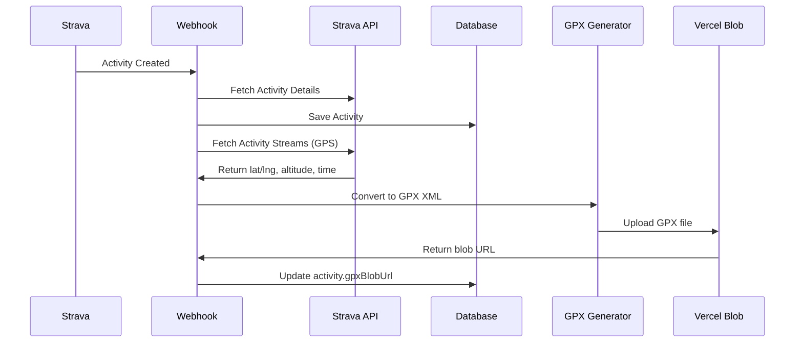

# GPX Storage - Quick Start

## ✅ What's Been Implemented

The app now automatically downloads and stores GPX files for Strava activities with GPS data!

### New Features

- ✅ Fetches activity GPS coordinates from Strava API
- ✅ Converts to standard GPX XML format
- ✅ Uploads to Vercel Blob Storage
- ✅ Stores blob URL in database
- ✅ Only downloads once (checks if already exists)
- ✅ Works for both create and update webhooks
- ✅ Non-blocking (won't fail webhook if GPX fails)

## 🚀 Setup (3 Steps)

### 1. Add Environment Variable

Add to your `.env` file:

```bash
BLOB_READ_WRITE_TOKEN="vercel_blob_rw_xxxxxxxxxxxxx"
```

**Get your token:**

1. Go to [Vercel Dashboard](https://vercel.com/dashboard)
2. Select your project
3. Go to Storage > Blob
4. Copy the `BLOB_READ_WRITE_TOKEN`

### 2. Run Database Migration

```bash
# Option A: Using db push (recommended for development)
npm run db:push

# Option B: Manual SQL (if db push doesn't work)
# Connect to your database and run:
# ALTER TABLE "activities" ADD COLUMN "gpxBlobUrl" TEXT;
```

### 3. Deploy

```bash
# Push to Vercel
git add .
git commit -m "Add GPX storage functionality"
git push

# Or deploy manually
vercel --prod
```

## 📦 What's Included

### New Files

1. **`lib/gpx-generator.ts`** - Fetches Strava streams and generates GPX
2. **`lib/gpx-storage.ts`** - Handles Vercel Blob uploads
3. **`GPX-STORAGE.md`** - Full documentation
4. **`.env.example`** - Updated with BLOB_READ_WRITE_TOKEN

### Modified Files

1. **`prisma/schema.prisma`** - Added `gpxBlobUrl` field
2. **`app/api/strava/webhook/route.ts`** - Integrated GPX processing
3. **`package.json`** - Added `@vercel/blob` dependency

## 🧪 Testing

### 1. Test with New Activity

```bash
# Create a new activity on Strava (go for a run/ride with GPS)
# Check your database:
SELECT id, name, "gpxBlobUrl" FROM activities ORDER BY "createdAt" DESC LIMIT 5;

# You should see URLs like:
# https://ccswg4jdqa1wbxt5.public.blob.vercel-storage.com/gpx/{userId}/{activityId}.gpx
```

### 2. Verify GPX File

```bash
# Download and check the GPX file
curl "https://ccswg4jdqa1wbxt5.public.blob.vercel-storage.com/gpx/..." -o test.gpx

# Open in text editor - should see XML like:
# <?xml version="1.0" encoding="UTF-8"?>
# <gpx version="1.1" creator="Giving the Distance">
#   <trk>
#     <trkpt lat="40.7128" lon="-74.0060">
#       ...
```

### 3. Check Webhook Logs

In Vercel Dashboard:

1. Go to Functions > Logs
2. Search for "GPX"
3. Look for:
   - `🎯 Generating GPX for activity...`
   - `✅ GPX stored successfully`

## 📊 Monitoring

### Database Queries

```sql
-- Activities with GPX files
SELECT COUNT(*) FROM activities WHERE "gpxBlobUrl" IS NOT NULL;

-- Activities without GPX (might be manual/indoor)
SELECT COUNT(*) FROM activities
WHERE "gpxBlobUrl" IS NULL AND "deletedAt" IS NULL;

-- Recent GPX downloads
SELECT
  id,
  name,
  type,
  "startDate",
  "gpxBlobUrl"
FROM activities
WHERE "gpxBlobUrl" IS NOT NULL
ORDER BY "createdAt" DESC
LIMIT 10;
```

### Blob Storage Usage

Check in Vercel Dashboard:

- Storage > Blob > giving-the-distance-app-blob
- View files and storage usage

## 🎯 How It Works



## 💡 Usage Examples

### In Your App

```typescript
// Fetch activity with GPX
const activity = await db.activity.findUnique({
  where: { id: activityId },
});

if (activity.gpxBlobUrl) {
  // Provide download link
  return (
    <a href={activity.gpxBlobUrl} download>
      Download GPX
    </a>
  );
}
```

### Add Download Button to Activity Page

```tsx
// In app/activities/[id]/page.tsx

{
  activity.gpxBlobUrl && (
    <a
      href={activity.gpxBlobUrl}
      download={`${activity.name}.gpx`}
      className="btn btn-secondary"
    >
      📥 Download GPX
    </a>
  );
}
```

## 🔍 Troubleshooting

### No GPX files being created

**Check:**

1. Is `BLOB_READ_WRITE_TOKEN` set?
   - Logs should show: "Blob storage not configured"
2. Do activities have GPS data?
   - Manual activities won't have GPS
   - Indoor workouts won't have GPS
3. Check Strava permissions
   - Need `activity:read_all` scope (you already have this!)

### GPX download fails

**Check webhook logs for:**

- `❌ Failed to fetch streams` - Strava API issue
- `❌ Error uploading GPX to Vercel Blob` - Blob token issue
- `⚠️ No GPS data available` - Activity has no GPS (normal for manual)

### Storage quota exceeded

**Solution:**

- Free tier: 500MB
- Pro tier: Unlimited ($0.15/GB/month)
- Typical GPX: 50-500KB per activity
- 500MB ≈ 1,000-10,000 activities

## 📚 More Information

- Full documentation: `GPX-STORAGE.md`
- Strava API docs: https://developers.strava.com/docs/reference/#api-Streams
- Vercel Blob docs: https://vercel.com/docs/storage/vercel-blob
- GPX format: https://www.topografix.com/gpx.asp

## ✨ Next Steps

1. **Add to Activity Page**: Show download button on activity detail pages
2. **Bulk Export**: Add admin feature to export all GPX files
3. **Map Preview**: Render GPX route on a map
4. **Stats**: Show GPX download statistics in admin dashboard

